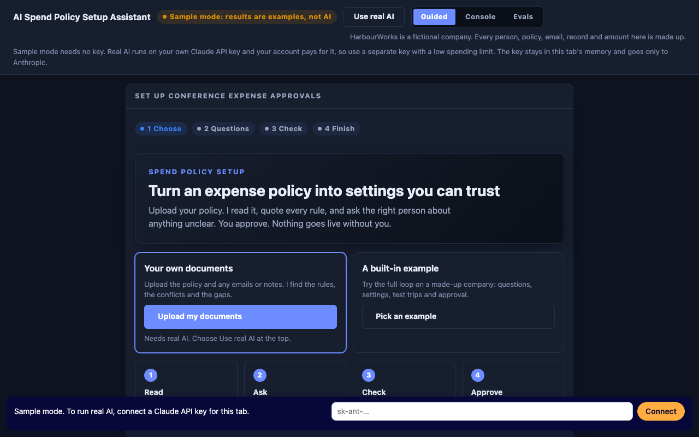
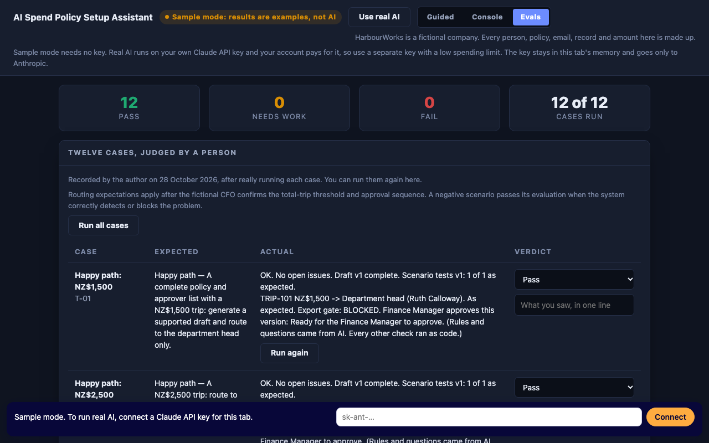

# AI Spend Policy Setup Assistant

**[Try the live demo](https://karishma0502-pixel.github.io/ai-spend-policy-assistant/)**: it opens in a labelled sample mode, with no key or sign-up.

Turns an ambiguous expense policy into a reviewed, tested set of approval rules. The AI proposes, code checks, and a person decides.

## The problem

A company's written expense policy rarely holds every decision a spend platform needs. "Conference spending above NZ$2,000 requires Finance approval" doesn't say whether the limit is per purchase or per trip, or who approves first. The Finance Manager setting it up is accountable for getting it right, but isn't the person who can decide what the policy means.

## How it works

| Step | Who does it | What happens |
|---|---|---|
| Read | AI | Extracts rules from the documents, quoting the source for each one |
| Ask | AI | Raises gaps and conflicts as focused questions, naming who must answer |
| Decide | A person | Records the answer. An answer from a role without authority is not accepted |
| Check | Code | Calculates trip totals and routes, and checks approvers, receipts and quotes |
| Approve | A person | Approves the exact draft version. Any later edit withdraws that approval |
| Export | Code | Stays blocked until issues are resolved and tests match the latest draft |

Nothing is applied to a live platform, no stakeholder is contacted, and no money moves. The prototype stops at a downloadable mock specification and review report.

## Evaluation

I ran 12 test cases with real AI on 28 October 2026 and judged each one myself: **12 Pass, 0 Needs work, 0 Fail**. The Evals tab in the demo shows every result and lets you run the cases again.

The cases cover routing, the exact NZ$2,000 boundary, split purchases, ambiguity, conflicting sources, unauthorised answers, missing approvers, self-approval and approval loops, missing receipts, instructions hidden in a document, edits after approval, and a simulator failure.

**What testing changed:** running the evals exposed a crash, which I fixed before recording these results. A later change makes the coverage check notice amounts that no question mentions, and that change came after the recorded run.

**What this doesn't show:** these are passes on fictional data in specific runs, and AI output varies between runs. No Finance Manager has piloted this, and no time saving has been measured.

## Run it

Use the [live demo](https://karishma0502-pixel.github.io/ai-spend-policy-assistant/), or open `index.html` in a browser. There is no build step.

Sample mode needs no key. Real AI needs your own Claude API key, and your account pays for what you run, so use a separate key with a low spending limit. The key is held in memory for that tab, sent only to Anthropic, and never stored in this repo.

## Limits

- It covers one fictional company and one conference policy, and isn't connected to a real spend platform.
- The CFO's answers are scripted. The page checks a chosen role against a fixed map and doesn't verify anyone's identity.
- Your own documents stop at rules, questions and an export of those. Drafting and scenario tests work on the built-in cases only.
- Quotes from a PDF can't be checked against the source, so use a `.txt` copy for that.
- Nothing is saved between visits.

All companies, people and amounts are fictional.

## Documents

- [Product requirements](docs/PRD.md)

## Credits

Built for the Product Faculty Agentic AI capstone. The page's design system and AI connection helper come from the Product Faculty capstone kit and remain theirs. No open-source licence is granted for this repo.
